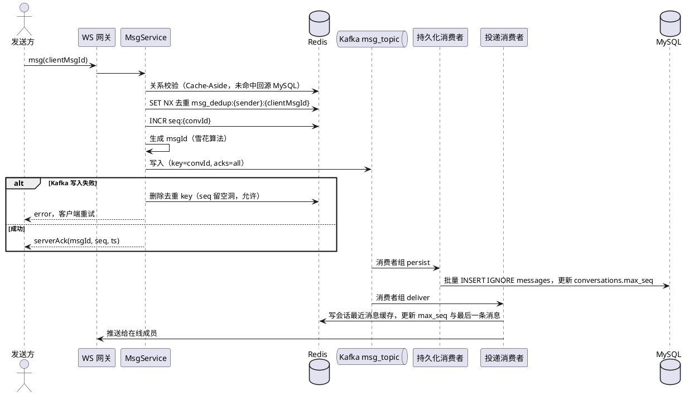

# IM 常规化改造计划

> 状态：已实施，未运行验证（本机无 Go/Docker，验证步骤见《消息链路修改记录》3.1）
> 范围：后端消息链路、会话与未读、同步协议、撤回/删除、关系缓存，以及配套前端改造
> 不在范围：多节点网关路由、多设备在线（保持单机、单设备）

## 1. 背景

当前消息链路是“Redis 优先”：发送 Lua 先在 Redis 里写入业务状态，再经 Redis Stream → Relay → Kafka → MySQL 归档。这样设计的问题是：

- Redis 成了消息的事实来源，必须按数据库标准运维，Stream + Relay + 失败待办让链路变长、变复杂。
- 私聊没有会话内 seq，同步靠时间戳游标，客户端无法发现漏消息。
- 消息、会话列表只在 Redis 里，被按 3 天或固定条数裁剪后就没有回源，历史消息查不到，不活跃会话会消失。
- 离线同步要遍历用户加入的所有群发件箱，开销跟群数量成正比。
- 撤回只改 Redis（WebSocket 路径不写 MySQL），删除复用撤回脚本，结果对双方生效。
- 好友和群成员校验依赖 Redis key 是否存在，缓存写失败就会误判。

改造前的完整链路见 [消息链路修改记录.md](./消息链路修改记录.md) 第 1 节。

## 2. 已确认的决策

| 问题 | 决策 |
| --- | --- |
| 发送回执时机 | 先写 Kafka（`acks=all`）成功再回 serverAck，MySQL 异步落库 |
| 消息表 | 私聊和群聊合并成一张 `messages` 表 |
| 上线方式 | 直接切换，不保留旧协议；一次性迁移历史数据 |
| 多节点 / 多设备 | 不做，保持单机、单设备登录 |

## 3. 目标设计

### 3.1 核心原则

- MySQL 是消息、会话、关系的事实来源；Redis 只做缓存、计数器和去重。
- Kafka 是消息写入的提交点：写入成功就代表消息已存在。
- 每个会话（私聊、群聊）一个连续递增的 `seq`，排序、同步、未读、撤回都基于 `(conv_id, seq)`。
- 消息体读扩散：一条消息只存一份；用户维度只存 `read_seq` 等少量状态。

### 3.2 发送链路



要点：

- 持久化和投递是两个独立的消费者组，互不阻塞；都按 `convId` 分区，保证会话内有序。
- 投递消费者先更新缓存再推送，客户端收到推送后去拉区间时一定能在缓存里命中。
- 推送失败（离线、`SendCh` 满）不重试，客户端靠 seq 空洞检测补拉。
- 持久化失败沿用现有 retry Topic + DLQ 机制。

### 3.3 数据模型

```sql
-- 消息表：私聊、群聊共用
CREATE TABLE messages (
    conv_id        VARCHAR(64)  NOT NULL,   -- p_{小ID}_{大ID} / g_{groupID}
    seq            BIGINT       NOT NULL,
    msg_id         BIGINT       NOT NULL,   -- 雪花 ID，全局唯一
    conv_type      TINYINT      NOT NULL,
    sender_id      BIGINT       NOT NULL,
    msg_type       TINYINT      NOT NULL,
    content        TEXT         NOT NULL,
    status         TINYINT      NOT NULL DEFAULT 0,  -- 0 正常 1 已撤回
    client_msg_id  VARCHAR(128) NOT NULL,
    created_at     DATETIME(3)  NOT NULL,
    PRIMARY KEY (conv_id, seq),
    UNIQUE KEY uk_msg_id (msg_id),
    UNIQUE KEY uk_client (sender_id, client_msg_id),
    FULLTEXT KEY ft_content (content)
);

-- 会话表：每个会话一行
CREATE TABLE conversations (
    conv_id        VARCHAR(64)  PRIMARY KEY,
    conv_type      TINYINT      NOT NULL,
    max_seq        BIGINT       NOT NULL DEFAULT 0,
    last_msg_id    BIGINT       NULL,
    last_msg_brief VARCHAR(256) NULL,
    last_sender_id BIGINT       NULL,
    last_msg_at    DATETIME(3)  NULL
);

-- 用户会话表：每个用户在每个会话里的状态
CREATE TABLE user_conversations (
    user_id     BIGINT      NOT NULL,
    conv_id     VARCHAR(64) NOT NULL,
    read_seq    BIGINT      NOT NULL DEFAULT 0,
    min_seq     BIGINT      NOT NULL DEFAULT 0,  -- 入群起点 / 清空记录
    pinned      TINYINT     NOT NULL DEFAULT 0,
    muted       TINYINT     NOT NULL DEFAULT 0,
    hidden      TINYINT     NOT NULL DEFAULT 0,
    updated_at  DATETIME(3) NOT NULL,
    PRIMARY KEY (user_id, conv_id)
);

-- 仅对自己生效的删除
CREATE TABLE user_deleted_messages (
    user_id  BIGINT      NOT NULL,
    conv_id  VARCHAR(64) NOT NULL,
    seq      BIGINT      NOT NULL,
    PRIMARY KEY (user_id, conv_id, seq)
);
```

### 3.4 Redis 用途（只做缓存和计数）

| Key | 类型 | 用途 | 丢失后果 |
| --- | --- | --- | --- |
| `seq:{convId}` | String | seq 计数器 | 启动和未命中时用 `max(seq)` 校正 |
| `msg_dedup:{uid}:{clientMsgId}` | String，TTL 5 分钟 | 发送去重 | DB 唯一键兜底 |
| `conv_msgs:{convId}` | ZSet（score=seq）+ Hash | 最近 N 条消息缓存 | 回源 MySQL |
| `conv_meta:{convId}` | Hash | max_seq、最后一条消息 | 回源 `conversations` |
| `friend:{a}:{b}`、`group_members:{gid}` | String / Set | 关系缓存 | 回源 MySQL |
| `online:{uid}` | String，TTL 60s | 在线状态 | 无影响 |

### 3.5 同步协议

1. 客户端上线：发送 `convSyncReq`，服务端返回该用户所有可见会话的 `max_seq`、`read_seq`、最后一条消息、置顶/免打扰。
2. 客户端对比本地每个会话的 `local_seq`，对有差异的会话发 `pullMsgs{convId, fromSeq, toSeq}`（每次最多 100 条）。
3. 服务端先查 `conv_msgs` 缓存，不完整则回源 MySQL。结果过滤 `seq < min_seq` 和用户已删除的消息。
4. 在线时收到推送：如果 `seq == local_seq + 1` 直接追加；否则按区间补拉。
5. 历史消息：`GET /api/v1/conversations/{convId}/messages?beforeSeq=&limit=` 分页。

### 3.6 会话与未读

- 会话列表 = `user_conversations`（用户状态）+ `conversations` / `conv_meta`（会话最新状态）读时合并，发送路径不再遍历成员。
- 未读 = `max_seq - max(read_seq, min_seq)`，私聊和群聊同一规则（自己发的消息在 readAck 时一并推进 read_seq）。
- `readAck{convId, seq}`：只允许 read_seq 前进（`GREATEST`），写 MySQL，同时更新缓存。
- 加好友、入群时写入 `user_conversations`；入群时 `min_seq = 当前 max_seq`。

### 3.7 撤回与删除

- 撤回：从 MySQL 校验发送者和 2 分钟时限 → `UPDATE messages SET status=1` → 发一条 `msg_type=撤回通知` 的系统消息走正常发送链路（分配 seq，内容为被撤回的 seq），离线用户同步时也能收到。缓存按 seq 直接覆盖，不再扫描整个 ZSet。
- 删除：写 `user_deleted_messages`，只对自己生效，无时间限制。
- 清空聊天记录：`min_seq = max_seq + 1`。

### 3.8 关系缓存

- 好友、群成员统一 Cache-Aside：先写 MySQL，再删除缓存；读取未命中时从 MySQL 加载并回填。
- 移除群成员改为先删 MySQL 再删缓存，删缓存失败要重试（或延迟双删），避免已移除成员继续发言。

## 4. 实施步骤

| 步骤 | 内容 | 完成标准 |
| --- | --- | --- |
| 1. 表结构与 seq | 新建 4 张表；迁移脚本把 `private_messages` 按会话、按 id 排序补 seq，`group_messages` 沿用 `group_seq`；把 Redis 里尚未落库的消息先补落库再迁移；seq 计数器启动校正 | 迁移脚本可重复执行，新旧表消息数一致 |
| 2. 发送链路 | MsgService 改为“校验 → 去重 → 分配 seq → 写 Kafka → serverAck”；新增雪花 ID 生成器；删除写入 Lua、Redis Stream、Relay、失败待办 | 单测覆盖成功、各类拒绝、Kafka 失败回滚去重 |
| 3. 消费者 | 新 `msg_topic`；persist 消费者批量幂等写库；deliver 消费者更新缓存后推送；删除 `private_msg_persist`、`group_msg_fanout`、`message_persist` 及对应消费者 | 消费者重启、重复消费后数据不重不乱 |
| 4. 同步与历史 | 新 WS 协议 `convSyncReq` / `pullMsgs`；历史分页 HTTP 接口；删除旧 `syncReq` 及按时间戳游标的同步 | 清空客户端本地数据后重新登录，能拉全历史 |
| 5. 会话与未读 | 会话列表读时合并；未读统一按 seq 差；readAck 改为 `{convId, seq}`；删除 `unread:*` 计数、`group_read_pos`、会话的 3 天清理 | 私聊、群聊未读一致，不活跃会话不消失 |
| 6. 撤回与删除 | 按 3.7 重写；HTTP 和 WS 撤回走同一个服务方法 | 离线用户上线后看到撤回结果；删除只影响自己 |
| 7. 关系缓存 | 好友、群成员改 Cache-Aside；修复好友缓存写失败导致无法发消息的问题 | 手动删除缓存后发送仍正常 |
| 8. 前端与收尾 | `chatStore` 按会话维护 seq、空洞补拉、历史分页、撤回通知；清理旧 Lua 和清理任务；更新架构文档和 API 文档；重新压测 | 端到端测试通过，压测数据更新到 `压力测试总结.md` |

步骤 1 到 7 是后端主体，步骤 8 的前端部分必须和后端一起上线（同步协议不兼容）。每完成一步，在 [消息链路修改记录.md](./消息链路修改记录.md) 第 3 节追加记录。

## 5. 风险与应对

- seq 空洞：Kafka 写失败或进程在 INCR 之后崩溃会产生空洞。客户端补拉时，区间内缺失的 seq 由服务端确认“不存在”后跳过，未读计算允许偏大一点。
- seq 重号：Redis 宕机恢复或计数器 key 丢失可能回退。启动时和 `INCR` 结果 ≤ 缓存的 `max_seq` 时，用 `MySQL max(seq)` 校正；`(conv_id, seq)` 主键兜底，冲突则重新分配。
- 推送早于落库：投递消费者和持久化消费者并行，推送时消息可能还没进 MySQL。区间拉取优先查缓存，缓存保留最近 N 条足够覆盖这个窗口。
- 迁移期间停服：直接切换方案需要短暂停服，迁移前确认 Stream 和失败待办已清空。
