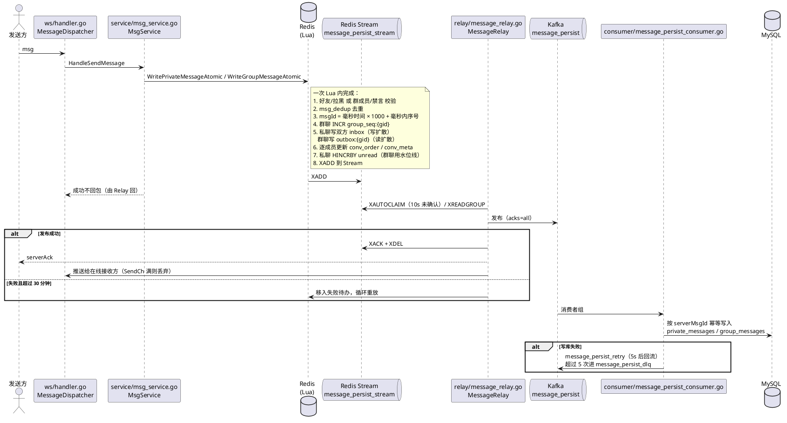
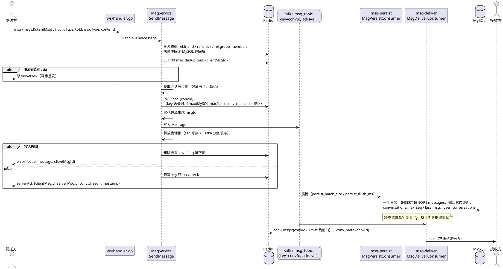
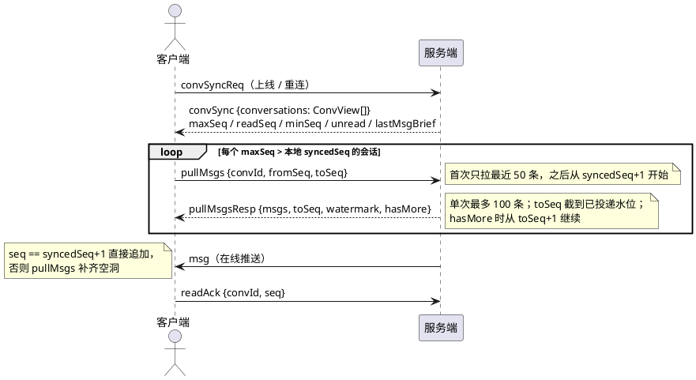

# 消息链路修改记录

本文记录 IM 常规化改造前的链路基线，以及改造过程中每一步的修改。改造计划见 [IM常规化改造计划.md](./IM常规化改造计划.md)。

## 1. 改造前链路（基线，2026-10-22）

### 1.1 发送链路

“Redis 优先”：发送 Lua 在 Redis 里一次原子执行完成全部业务写入，Redis Stream 作为 Outbox，由进程内 Relay 转发给 Kafka，再由消费者落库 MySQL。serverAck 和推送都在 Kafka 确认之后由 Relay 发出。

关键代码：

- 发送入口：[msg_service.go](../internal/service/msg_service.go) `HandleSendMessage`
- 写入 Lua：[lua_message_write.go](../internal/redis/lua_message_write.go)
- Relay：[message_relay.go](../internal/relay/message_relay.go)
- 落库消费者：[message_persist_consumer.go](../internal/consumer/message_persist_consumer.go)
- 旧版兼容路径（`atomicPipeline=false` 时）：`ExecPrivateMsgCheck` / `ExecGroupMsgCheck` → `private_msg_persist` / `group_msg_fanout` Topic → [private_msg_consumer.go](../internal/consumer/private_msg_consumer.go) / [group_msg_consumer.go](../internal/consumer/group_msg_consumer.go)

### 1.2 ID 与 seq

| 项 | 分配方式 | 范围 |
| --- | --- | --- |
| `serverMsgId` | Redis `TIME` 毫秒 × 1000 + `INCR msg_id_seq:{ms}`（每毫秒最多 999） | 全局唯一，按时间递增 |
| `groupSeq` | `INCR group_seq:{gid}` | 仅群聊，群内连续 |
| 私聊 seq | 无 | — |

### 1.3 存储

Redis（事实来源，需 AOF + 主从，禁止淘汰）：

| Key | 内容 |
| --- | --- |
| `inbox_order:{uid}` + `inbox_data:{uid}`，旧 `inbox:{uid}` | 私聊消息，每人一份，最多 2000 条（清理任务按 3 天 / 1000 条再裁） |
| `outbox_order:{gid}` + `outbox_data:{gid}`，旧 `outbox:{gid}` | 群聊消息，每群一份，最多 2000 条（清理任务按 3 天 / 500 条再裁） |
| `conv_order:{uid}` + `conv_meta:{uid}` | 会话列表，发送时逐成员写入，清理任务按 3 天删除 |
| `unread:{uid}` | 私聊未读计数 |
| `group_seq:{gid}`、`group_read_pos:{uid}` | 群聊未读水位线 |
| `friend:{a}:{b}`、`blacklist:{uid}`、`group_members:{gid}`、`group_member_info:{gid}` | 发送校验依赖的关系数据 |
| `message_persist_stream`、失败待办 | Outbox |

MySQL（异步归档）：`private_messages`、`group_messages`（按 `id` 主键幂等）、`msg_revoked`。

### 1.4 同步、已读、撤回

- 离线同步 `syncReq{lastSyncTime, lastSyncMsgID}`：读私聊收件箱，并遍历用户所有群的发件箱，按时间合并后返回 `SyncBatch`，再推 `ConvSync`（会话列表 + 未读）。只读 Redis，超出缓存的消息查不到，后端没有历史消息接口。
- 已读 `readAck`：私聊清零 `unread`；群聊写 `group_read_pos`。
- 撤回：Lua 扫描整个 `inbox:`/`outbox:` ZSet，逐条解码找到消息后替换，2 分钟时限。WebSocket 撤回不写 MySQL；HTTP 撤回写 `msg_revoked`，失败只打日志。删除消息复用撤回脚本，对双方生效。

### 1.5 关系写入顺序

- 加好友：先写 MySQL，再写 Redis 好友缓存，缓存失败只打 Warn（会导致无法发消息）。
- 加群成员：先写 MySQL，再写 Redis，Redis 失败返回错误。
- 移除群成员：先删 Redis，再删 MySQL。
- 私聊发送没有缓存未命中回源；群聊发送在“非成员”时会从 MySQL 回填一次缓存再重试。

### 1.6 连接与推送

单机：`sync.Map` 按 userID 管理连接，单设备登录（新连接踢掉旧连接），推送只能投到本进程连接，`SendCh`（容量 256）满了就丢弃。

### 1.7 不涉及改造的部分

朋友圈：发布 → `moment_push` → 推拉结合（普通用户写扩散到好友时间线，大 V 只写寄件箱，读取时合并），点赞、评论异步落库。本次不改。

## 2. 改造后链路（2026-10-22）

### 2.1 职责划分

| 组件 | 职责 |
| --- | --- |
| MySQL | 事实来源：`messages`、`conversations`、`user_conversations`、`user_deleted_messages`，以及好友、群成员 |
| Kafka `msg_topic` | 写入提交点。按 `convId` 分区，两个独立消费者组 `msg-persist`（落库）和 `msg-deliver`（缓存 + 推送） |
| Redis | 只做缓存、计数器、去重，丢了可以从 MySQL 重建 |
| `msg_topic_dlq` | seq/clientMsgId 冲突的消息、重试达到上限的批次 |

### 2.2 发送链路

### 2.3 同步、未读、已读

- 未读：`maxSeq - max(readSeq, minSeq)`，私聊和群聊同一规则，读时计算；区间不超过 1000 条时，再用一条批量 SQL 扣除区间内的撤回通知（msgType=6）、已撤回消息（status=1）和自己发的消息。尚未落库的毫秒级窗口不在校正范围内。
- 已投递水位 `watermark = max(MySQL max(seq), conv_meta.seq)`：补拉的 `toSeq` 截到水位，客户端据此推进 `syncedSeq`。水位以下缺失的 seq 一定是空洞（Kafka 写失败），水位以上的是还在途的消息，不会被客户端误跳过。
- 会话列表的对端用户资料、群名称改为两次批量查询（原来逐个查询，N+1）。
- 已读位置只进不退（`GREATEST`）。
- 读区间时先查 Redis 热窗口；不完整时回源 MySQL，再与缓存合并（缓存里可能有尚未落库的消息），最后过滤 `minSeq` 之前的消息和用户删除的消息。
- 历史分页：`GET /api/v1/conversations/{convId}/messages?beforeSeq=&limit=`。

### 2.4 撤回与删除

- 撤回（WS `revokeMsg {convId, seq}` 和 HTTP `POST /msg/revoke` 走同一个方法）：校验是本人发的、2 分钟内，然后发送一条 `msgType=6` 的通知消息，content 为 `{targetSeq, targetMsgId, operatorId}`。它走正常发送链路，会分配 seq：
  - persist 落库时把原消息改成 `status=1`；
  - deliver 修改缓存，并推送给其他成员；
  - 发起方收到的 serverAck 中 `clientMsgId = revoke:{convId}:{seq}`；
  - 离线用户补拉时也能收到这条通知。
- 删除 `DELETE /msg/{seq}?convId=`：写 `user_deleted_messages`，只对自己生效。
- 清空 `POST /conversations/{convId}/clear`：`minSeq = maxSeq + 1`。
- 删除会话 `DELETE /conversations/{convId}`：先清空，再隐藏；私聊收到新消息后会重新出现。

### 2.5 关系缓存

- 好友、拉黑、群成员统一采用 Cache-Aside：先写 MySQL，再删除缓存，500ms 后再删一次（延迟双删，覆盖"读到旧值后回填"的并发窗口）；读取未命中时从 MySQL 加载并回填。TTL：好友、拉黑 1 小时，群成员 10 分钟（作为双删也失败时的兜底）。
- key 加了 `rel:` 前缀。原因：旧版 `group_members:{gid}` 是 Set 类型，新缓存是 JSON String，同名会出现 WRONGTYPE 错误，导致每次都穿透到 MySQL。
- 加好友、建群、入群时写 `user_conversations`；入群时 `min_seq = 当前已分配 seq + 1`（已存在的行不改可见下界，只取消隐藏）。退群或被移除时删除这一行。

### 2.6 前端

- `chatStore` 为每个会话维护三个位置：`maxSeq`、`syncedSeq`、`readSeq`。
- 消息按 seq 去重。排序为全序：已确认消息按 seq 升序，待确认消息排在其后按本地时间。待确认的本地消息用 `clientMsgId` 关联，收到 serverAck 后写入 seq。
- 收到 `msgType=6` 的通知不展示，只把目标 seq 对应的消息标为已撤回；目标是他人发的未读消息时未读数减 1。
- `error` 帧按 `clientMsgId` 把对应消息标为失败；`revoke:` 前缀的错误弹出"撤回失败"提示；不带 `clientMsgId` 的错误不影响消息状态。
- 补拉由 `realtime/pullScheduler.ts` 调度：同一会话最多一个在途请求，后续请求合并，返回后按 `syncedSeq` 重算。
- 消息列表滚动到顶部时通过 HTTP 历史接口向前翻页（`prependHistory`），不影响 `syncedSeq`。
- 所有雪花 ID（`msgId`、`serverMsgId`、`targetMsgId`）按字符串处理。

## 3. 修改记录

| 日期 | 步骤 | 修改内容 | 涉及文件 | 验证 |
| --- | --- | --- | --- | --- |
| 2026-10-22 | 0. 规划 | 记录改造前链路基线，确认改造计划 | `docs/IM常规化改造计划.md`、`docs/消息链路修改记录.md` | — |
| 2026-10-22 | 1. 表结构与 seq | 新建 `messages` / `conversations` / `user_conversations` / `user_deleted_messages`；迁移旧消息：私聊按 id 排序补 seq，群聊沿用 group_seq | `scripts/migrations/013_*.sql`、`014_*.sql` | 未运行（本机无 Docker） |
| 2026-10-22 | 2. 发送链路 | MsgService 重写：校验 → 去重 → INCR seq → 生成雪花 ID → 写 Kafka → serverAck；删除写入 Lua、Redis Stream、Relay、失败待办 | `service/msg_service.go`、`pkg/idgen`、`repository/message_cache.go`、`repository/mq_repo.go` | 未运行 |
| 2026-10-22 | 3. 消费者 | 新增 `msg_topic` 和两个消费者组 persist / deliver，冲突消息投 `msg_topic_dlq`；删除旧 Topic 和对应消费者 | `consumer/msg_persist_consumer.go`、`consumer/msg_deliver_consumer.go`、`infra/kafka.go` | 未运行 |
| 2026-10-22 | 4. 同步与历史 | WS 新增 `convSyncReq` / `convSync` / `pullMsgs` / `pullMsgsResp`，删除 `syncReq` / `syncBatch` / `deliverAck` / `msgRevoked`；新增会话 HTTP 接口 | `protocol/protocol.go`、`ws/handler.go`、`api/conv_handler.go` | 未运行 |
| 2026-10-22 | 5. 会话与未读 | 会话列表读时合并；未读按 seq 差计算；`readAck {convId, seq}`；删除 `unread:*`、`group_read_pos`、会话 3 天清理 | `repository/message_store.go`、`infra/cleanup.go` | 未运行 |
| 2026-10-22 | 6. 撤回与删除 | 撤回改为 msgType=6 的通知消息，HTTP 和 WS 共用；删除只对自己生效；新增清空、删除会话；删除 msg_op_service | `service/msg_service.go`、`api/msg_op_handler.go`、`api/response.go` | 未运行 |
| 2026-10-22 | 7. 关系缓存 | 好友、拉黑、群成员改为 Cache-Aside，key 加 `rel:` 前缀，避免与旧 Set 类型 key 冲突；friend/group service 维护 user_conversations | `repository/relation_cache.go`、`service/friend_service.go`、`service/group_service.go`、`benchmark/setup_friends.go` | 未运行 |
| 2026-10-22 | 8a. 组装与测试 | main.go 和 e2e 统一组装方式；配置新增 `message` 段（node_id、persist_batch_size、persist_flush_ms）；mock、friend/group 单测按新接口改写；e2e 改写并新增 `TestE2E_ConvSyncAndSeqPull`（seq 连续、幂等重发、convSync 未读、补拉、beforeSeq 分页） | `cmd/server/main.go`、`configs/*.yaml`、`service/*_test.go`、`tests/e2e_*.go` | 未运行 |
| 2026-10-22 | 8b. 清理迁移 | 新增 015：包含校验 SQL；DROP 旧表的语句默认注释，确认后手动执行；附带 Redis 旧 key 的清理命令 | `scripts/migrations/015_drop_legacy_message_tables.sql` | 未运行 |
| 2026-10-22 | 8c. 前端 | WS/HTTP 类型按新协议重写；chatStore 改为 seq 模型（convSync 对比、空洞补拉、hasMore 续拉、撤回通知、按 clientMsgId 标记失败）；readAck 和撤回改为按 seq；新增 conversationsApi；单测改写 | `frontend/goim-ws-types.ts`、`goim-api-types.ts`、`src/stores/chatStore.ts`、`src/components/realtime/RealtimeBootstrap.tsx`、`src/pages/ChatPage.tsx`、`src/api/messages.ts`、`src/test/chatStore.test.ts` | 未运行 |
| 2026-10-22 | 8d. 文档 | 填写本文第 2 节；重写前端 WS 协议、更新接口契约与实施流程；更新后端 API 参考文档、项目系统架构、接口测试清单第 6 节与 7.6（改为未勾选的 v2 待测项）；handler 中 swag 注释已更新，但生成的 `docs.go` / `swagger.json` / `swagger.yaml` 仍是旧版，需要执行 `swag init` 重新生成 | `backend/docs/*.md`、`frontend/docs/*.md`、`protocol/protocol.go`（注释） | — |
| 2026-10-22 | 9a. review 后端 | 入群 min_seq=CurrentSeq+1；会话分片锁 + 已投递水位截断补拉；雪花 ID JSON 改字符串；未读扣除撤回/自己发的消息；会话列表批量查资料；persist 解析失败进 DLQ；群成员缓存 TTL 10 分钟 + 延迟双删；limit 截断；补 msg_service / persist 单测 | `model/message.go`、`repository/message_store.go`、`repository/relation_cache.go`、`service/msg_service.go`、`service/group_service.go`、`consumer/msg_persist_consumer.go`、`cmd/server/main.go`、`tests/e2e_*.go`、`service/*_test.go`、`consumer/msg_persist_consumer_test.go` | 未运行 |
| 2026-10-22 | 9b. review 前端 | ID 改字符串、补拉按 watermark 推进；排序改全序；补拉在途去重；撤回失败提示；撤回扣未读；上滑加载历史；单测同步并新增 | `goim-ws-types.ts`、`goim-api-types.ts`、`src/stores/chatStore.ts`、`src/realtime/pullScheduler.ts`、`src/components/realtime/RealtimeBootstrap.tsx`、`src/pages/ChatPage.tsx`、`src/test/*.test.ts` | 未运行 |

### 3.1 已知风险（可接受，后续再优化）

- Kafka 写入结果不确定（超时但实际已写入）时，客户端用同一个 clientMsgId 重试，会分配到新的 seq。落库时 `uk_client` 冲突，后一条进 DLQ，但 deliver 可能已经推送过一次，接收方会看到重复消息。
- seq 计数器丢失后用 `max(MySQL max(seq), conv_meta.seq)` 校正，此时还没落库也没进缓存的消息可能和新分配的 seq 冲突，冲突消息进 DLQ。
- 会话锁让同一会话的发送串行化，单会话吞吐上限约等于 1 / Kafka 写延迟（acks=all 下几毫秒一条），对聊天场景足够，但大群刷屏时会排队。锁只在单机内有效，多机部署需要换成按 convId 路由到固定节点或分布式锁。
- 雪花 ID 改为字符串后，Kafka 里旧格式（数字）的积压消息无法再解析，切换前需要清空 `msg_topic` 积压（解析失败的会进 DLQ，不会丢）。
- 清理任务把 timeline 限制在 100 条，与配置 `timeline_max_len=1000` 不一致（改造前就存在）。
- 整个改造没有实际运行过：本机没有 Go 和 Docker，只靠阅读代码保证能编译。上线前需要执行 `go build ./...`、`go test ./...`、e2e 测试，以及前端的 `npm run typecheck` 和 `npm test`。
- Swagger 生成文件仍是旧接口（如 `/msg/{msgID}`），不影响编译，有 Go 环境后在 `backend` 目录执行 `swag init -g cmd/server/main.go -o docs` 重新生成。

### 3.2 review 结论（2026-10-22）

| # | 问题 | 结论 | 理由 / 做法 |
| --- | --- | --- | --- |
| 1 | 入群 min_seq 用 max_seq，新成员能看到在途消息 | 采纳 | 改为 `CurrentSeq + 1`（已分配 seq，而不是已落库 seq） |
| 2 | 补拉 toSeq 超过已投递位置，客户端把在途消息当空洞跳过 | 采纳，且比 review 描述更深 | 并发发送时 seq 顺序和 Kafka 顺序可能不一致，单靠水位不够。加会话锁保证顺序一致，再按已投递水位截断 |
| 3 | 雪花 ID 超过 JS 安全整数 | 采纳 | JSON 改字符串（`,string`），直接切换不兼容旧格式 |
| 4 | 撤回通知、自己发的消息计入未读 | 采纳 | 按 MySQL 批量计数扣除，区间超过 1000 不校正 |
| 5 | 群成员缓存一致性与结构 | 部分采纳 | 缩短 TTL + 延迟双删；不改 Hash/Set，500 人上限下 JSON 解析成本可接受 |
| 6 | 会话列表 N+1 | 采纳 | 改两次批量查询；不改异步，批量后耗时已可忽略 |
| 7 | persist 解析失败直接跳过 | 采纳 | 进 DLQ 保留原始 offset；deliver 侧仍丢弃，因为 persist 已留存 |
| 8 | 撤回失败无提示 | 采纳 | 前端弹出提示 |
| 9 | 历史分页未接入 | 采纳 | 上滑加载 |
| 小 | limit 无上限 | 采纳 | `clampLimit` |
| 小 | sortMessages 非全序 | 采纳 | 已确认按 seq，待确认在后 |
| 小 | 空洞重复 pull | 采纳 | 水位截断 + 前端在途去重 |
| 小 | 删好友不清理会话 | 不采纳 | 常规 IM 做法是保留会话和记录，发送时由关系校验拦截 |
| 小 | `seq:{convId}` 无 TTL | 不采纳 | 计数器是会话的生命周期数据，加 TTL 反而会频繁触发校正；丢失后可自动校正 |
