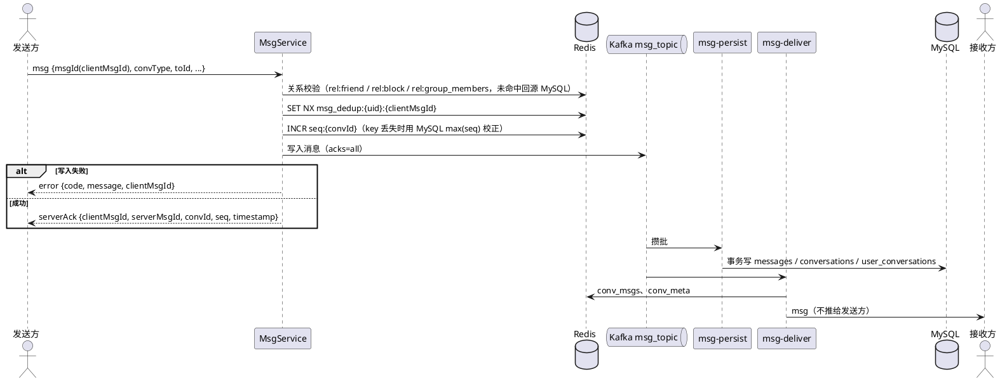

# GoIM 系统架构

## 概述

GoIM 是单机部署的即时通讯服务，消息链路采用常规 IM 设计：MySQL 是事实来源，Kafka 是写入提交点，Redis 只做缓存、计数和去重。私聊和群聊统一按"会话 + seq"组织，客户端通过对比 seq 发现并补齐缺失消息。

- 单机、单设备：同一用户只保留一个 WebSocket 连接，新连接踢掉旧连接。
- 发送成功的标志：消息写入 Kafka（acks=all）后才回 `serverAck`。
- Redis 数据丢失不影响正确性，会话、历史、未读都可以从 MySQL 重建。

详细链路与改造过程见 `消息链路修改记录.md`，协议见 `frontend/docs/WebSocket协议.md`。

## 架构图

```
                    ┌──────────────────────────────────────┐
  客户端 ──HTTP──▶ │  Gin 路由 /api/v1                    │
                    │   /auth /friend /group /moment       │
                    │   /conversations /msg /settings      │
  客户端 ──WS────▶ │  /ws?token=JWT                       │
                    │                                      │
                    │  MsgService ──写入──▶ Kafka msg_topic│──┐
                    │      │                (key=convId)   │  │
                    │      ▼                               │  │
                    │   Redis（seq / 去重 / 关系缓存）     │  │
                    └──────────────────────────────────────┘  │
                                                              │
               ┌──────────────────────────┬───────────────────┘
               ▼                          ▼
     msg-persist 消费者组         msg-deliver 消费者组
     攒批事务写 MySQL             更新 Redis 热窗口，推送在线接收方
               │
               ▼
     MySQL messages / conversations / user_conversations
```

## 消息数据流

### 发送（私聊和群聊同一条链路）



- 私聊和群聊的区别只在关系校验和接收者集合，群聊是读扩散：消息只在会话里存一份，未读按 seq 差值计算，不给每个成员写一份。
- seq 在写 Kafka 前分配；写入失败时这个 seq 被跳过，所以 seq 允许空洞。
- 落库冲突的消息投递到 `msg_topic_dlq`，整批失败时退避重试。

### 同步、未读与已读

1. 客户端上线或重连时发送 `convSyncReq`，服务端返回全部会话的 `maxSeq / readSeq / minSeq / unread`。
2. 客户端对比本地 `syncedSeq`，用 `pullMsgs {convId, fromSeq, toSeq}` 补拉，单次最多 100 条，`hasMore` 时继续拉。
3. 在线推送的 seq 不连续时，补拉中间缺失的区间。
4. 已读上报 `readAck {convId, seq}`，已读位置只前进不回退。
5. 未读 = `maxSeq - max(readSeq, minSeq)`，私聊和群聊用同一规则，读取时计算。
6. 读取区间时先查 Redis 热窗口，不完整时回源 MySQL，并过滤清空位置之前的消息和用户自己删除的消息。

### 撤回、删除与清空

- 撤回：发送者 2 分钟内可撤回，服务端生成一条 `msgType=6` 的通知消息，走正常发送链路并占用一个 seq；persist 把原消息改为 `status=1`，deliver 推送通知。
- 删除消息：只对自己生效，写 `user_deleted_messages`。
- 清空会话：只对自己生效，把 `minSeq` 推进到当前 `maxSeq + 1`；删除会话在清空的基础上从列表隐藏，私聊有新消息时会重新出现。

### 朋友圈动态流

```
作者 ── POST /moment ──▶ InsertMySQL(动态) ──▶ MQ moment_push
                                               │
                         消费者：普通用户写扩散到好友 timeline:{uid}，
                         大 V 只写 moment_outbox:{uid}，读取时合并
好友 ── GET /moment/feed ──▶ 合并 timeline 与关注的大 V 发件箱
```

## Redis 键结构

| 键模式 | 类型 | TTL | 用途 |
|--------|------|-----|------|
| `seq:{convId}` | String（INCR） | — | 会话 seq 计数器，丢失时用 MySQL 校正 |
| `conv_msgs:{convId}` | ZSet（score=seq） | 7 天 | 最近 200 条热消息窗口 |
| `conv_meta:{convId}` | Hash | 7 天 | 会话最新 seq 与最后一条消息摘要 |
| `msg_dedup:{uid}:{clientMsgId}` | String（pending 或 serverAck JSON） | 5 分钟 | 发送去重，重复请求直接返回原 ack |
| `rel:friend:{a}:{b}` / `rel:block:{a}:{b}` | String（"1"/"0"） | 1 小时 | 好友、拉黑关系缓存，否定结果同样缓存 |
| `rel:group_members:{gid}` | String（成员 JSON，含角色与禁言截止时间） | 1 小时 | 群成员缓存 |
| `timeline:{uid}` | ZSet（score=时间戳） | 定期修剪 | 朋友圈收件箱 |
| `moment_outbox:{uid}` | ZSet | — | 大 V 朋友圈发件箱 |
| `online:{uid}` / `conn:{uid}` | String | 60 秒 | 在线状态与活跃连接标识 |

`rel:` 前缀用于和旧版 Set 类型的关系 key 区分，避免类型冲突。

## MySQL 消息表

| 表 | 主键 / 唯一键 | 用途 |
|----|---------------|------|
| `messages` | `(conv_id, seq)`，`uk_msg_id`，`uk_client (sender_id, client_msg_id)` | 私聊和群聊统一的消息表，`content` 带 ngram 全文索引 |
| `conversations` | `conv_id` | 会话 `max_seq` 与最后一条消息 |
| `user_conversations` | `(user_id, conv_id)` | 每个用户的 `read_seq`、`min_seq`、置顶、免打扰、隐藏 |
| `user_deleted_messages` | `(user_id, conv_id, seq)` | 仅对自己删除的消息 |

旧的私聊、群聊分表由 `015_drop_legacy_message_tables.sql` 删除。

## 后台任务

- 消息相关 key 写入时自带长度上限和 TTL，不需要后台扫描。
- 清理任务只修剪 `timeline:*`：删除超过 3 天的条目，每个用户最多保留 100 条。

## 安全

- JWT 认证：访问令牌 2 小时，刷新令牌 7 天。
- bcrypt 密码哈希，成本因子 10。
- 单设备策略：新连接会踢掉旧连接。
- 消息去重：客户端生成的 clientMsgId + Redis SETNX（5 分钟）+ MySQL `uk_client` 兜底。
- 发送校验：私聊检查好友和拉黑关系，群聊检查成员身份和禁言状态；撤回检查发送者和时间窗口。
