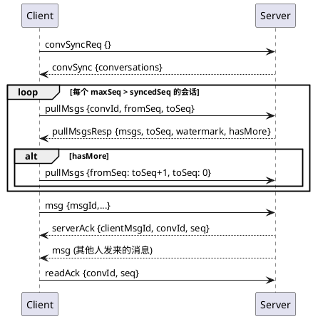

# GoIM WebSocket 协议（v2，基于会话 seq）

本协议对应当前服务端实现与 `frontend/goim-ws-types.ts`。连接地址为 `ws://<host>/ws?token=<accessToken>`；令牌缺失或无效时握手返回 HTTP 401，前端应刷新令牌或回到登录页。

v2 直接替换 v1，不兼容旧帧（`syncReq`、`syncBatch`、`deliverAck`、`msgRevoked` 已删除）。

## 消息模型

- 私聊和群聊统一为"会话"：私聊 `p_{较小用户ID}_{较大用户ID}`，群聊 `g_{groupID}`。
- 每个会话维护单调递增的 `seq`，由服务端在写入 Kafka 前分配；`convId + seq` 唯一定位一条消息，`msgId` 为服务端全局唯一的雪花 ID，JSON 中以字符串传输（`msgId`、`serverMsgId`、`targetMsgId` 均如此，数值超过 JS 安全整数）。Kafka 写入失败时已分配的 seq 会被跳过，因此 seq 允许空洞。
- 已投递水位 `watermark`：服务端已确认投递（落库或进入热缓存）的最大 seq。`pullMsgsResp.toSeq` 不会超过水位，水位以下仍缺失的 seq 就是空洞，客户端可以直接越过；水位以上的消息还在途，稍后会推送或下次再拉。
- 服务端回 `serverAck` 表示消息已写入 Kafka（acks=all），之后一定会落库并投递。同一会话的 seq 分配与 Kafka 写入在单机内串行，seq 顺序与 Kafka 分区顺序一致。
- 未读数 = `maxSeq - readSeq`，再扣除区间内的撤回通知、已撤回消息和自己发的消息（区间不超过 1000 条时精确扣除）；已读位置只前进不回退。
- 撤回不是独立帧，而是一条 `msgType=6` 的普通消息，`content` 为 `{"targetSeq","targetMsgId","operatorId"}` 的 JSON 字符串。
- 入群时 `minSeq = 当前已分配 seq + 1`，新成员看不到入群前的消息。

## 连接与心跳

- 同一用户只允许一个活跃连接（不支持多设备）。新连接建立后，旧连接收到 `{ "type": "kick", "reason": "new_login" }` 并被关闭；该消息是唯一不带 `data` 的应用消息。
- 单条文本帧最大 4096 字节，服务端每 30 秒发送 WebSocket 原生 Ping，60 秒未收到 Pong 即关闭连接。浏览器会自动响应，前端无需发送 JSON 心跳。
- 断线后指数退避重连；连接成功立即发送 `convSyncReq`。收到 `kick` 时停止重连并清除登录态。

除 `kick` 外，所有应用消息格式为 `{"type":"...","data":{...}}`，未知 `type` 会被服务端忽略。

## 客户端 → 服务端

| type | data | 语义 |
| --- | --- | --- |
| `msg` | `{ msgId, convType, toId, msgType, content, timestamp? }` | 发送消息。`msgId` 是客户端生成的 clientMsgId，重试时必须复用（服务端 5 分钟内去重）；`toId` 私聊为对方用户 ID，群聊为群 ID；`timestamp` 仅本地展示，服务端以自身时间为准。|
| `readAck` | `{ convId, seq }` | 把该会话的已读位置推进到 `seq`。|
| `convSyncReq` | `{}` | 请求全部会话视图，服务端回 `convSync`。|
| `pullMsgs` | `{ convId, fromSeq, toSeq }` | 按 seq 闭区间补拉；`toSeq<=0` 表示拉到最新。单次最多返回 100 条。|
| `revokeMsg` | `{ convId, seq }` | 撤回自己发送的消息（2 分钟内）。|

## 服务端 → 客户端

| type | data | 前端动作 |
| --- | --- | --- |
| `serverAck` | `{ clientMsgId, serverMsgId, convId, seq, timestamp }` | 用 `clientMsgId` 找到待确认消息，写入 `seq`/`serverMsgId` 并改为已发送。撤回请求的 ack 中 `clientMsgId` 为 `revoke:{convId}:{seq}`。|
| `msg` | `WsMessage` | 按 seq 合并进会话。服务端不会把消息推回给发送者本人。|
| `convSync` | `{ conversations: ConvView[] }` | 用服务端视图覆盖本地 `maxSeq`/`readSeq`/`unread`/置顶/免打扰，并按需发起 `pullMsgs`。|
| `pullMsgsResp` | `{ convId, fromSeq, toSeq, watermark, msgs, hasMore }` | 合并消息，`syncedSeq` 推进到 `min(toSeq, watermark)`；`hasMore=true` 时从 `toSeq+1` 继续拉。|
| `groupAdded` | `{ groupId, name }` | 新增群会话入口。|
| `groupRemoved` | `{ groupId, reason }` | 移除对应群会话。|
| `error` | `{ code, message, clientMsgId? }` | 带 `clientMsgId` 时表示该条发送失败（撤回失败时为 `revoke:` 前缀）；`readAck`、`pullMsgs`、`convSyncReq` 失败不带 `clientMsgId`。|
| `kick` | 无 `data`，`{ type, reason }` | 清除令牌、关闭连接并跳转登录。|

`WsMessage`：`{ convId, seq, msgId, convType, fromId, msgType, content, status, clientMsgId?, timestamp }`，`status` 为 0 正常、1 已撤回。

`ConvView`：`{ convId, convType, targetId, targetName, targetAvatar, maxSeq, readSeq, minSeq, unread, lastMsg?, lastMsgBrief, lastMsgTime, pinned, muted }`。`minSeq` 是用户清空记录后可见的最小 seq。

错误码：`4001` 非好友、`4002` 被拉黑、`4003` 重复消息、`5001` 非群成员、`5002` 被禁言、`1401` 不可撤回、`1402` 非发送者、`1404` 会话不存在、`400`/`500` 通用错误。

## 前端状态机

每个会话在本地维护三个位置：`maxSeq`（服务端已知最大 seq）、`syncedSeq`（本地已连续拉到的 seq）、`readSeq`（已读位置）。

1. 发送：生成 UUID 作为 `msgId`，插入待确认的本地消息；收到 `serverAck` 后写入 seq。收到带该 `clientMsgId` 的 `error` 时标记失败，允许用同一 `msgId` 重试。
2. 上线/重连：发送 `convSyncReq`。对每个 `ConvView`，若 `maxSeq > syncedSeq` 则发送 `pullMsgs`：
   - 本地从未同步过（`syncedSeq=0`）：只拉最近 50 条，`fromSeq = max(1, minSeq, maxSeq-49)`；
   - 否则拉 `[syncedSeq+1, maxSeq]`。
3. 推送：收到 `msg` 时，若 `seq == syncedSeq+1` 直接追加并推进；若跳号则补拉 `[syncedSeq+1, seq]`；`syncedSeq=0` 时直接采纳。所有消息按 `seq` 去重。同一会话同时最多一个 `pullMsgs` 在途，期间产生的补拉请求只保留最后一个，返回后按新的 `syncedSeq` 重算区间（10 秒未返回视为丢失；重连时清空）。
4. 排序：已确认消息按 `seq` 升序，待确认消息（无 seq）统一排在其后按本地时间排序。
5. 撤回通知：解析 `content`，把 `targetSeq` 对应消息标为已撤回并替换为"消息已撤回"，不弹桌面通知；若原消息是他人发的且在 `readSeq` 之后，未读数减 1。撤回失败（`error` 帧 `clientMsgId` 为 `revoke:` 前缀）时弹出提示。
6. 已读：打开会话时取当前最大 seq，大于本地 `readSeq` 才发送 `readAck { convId, seq }`。
7. 更早的历史：消息列表滚动到顶部时，通过 HTTP `GET /conversations/:convId/messages?beforeSeq=<本地最小 seq>&limit=30` 向前翻页，只合并消息，不改变 `syncedSeq` / `maxSeq`。

## 未纳入的消息

`friendApply`、`friendAccepted`、`presence`、应用层 `ping`/`pong`、多设备同步均未实现，好友操作使用 HTTP API。
